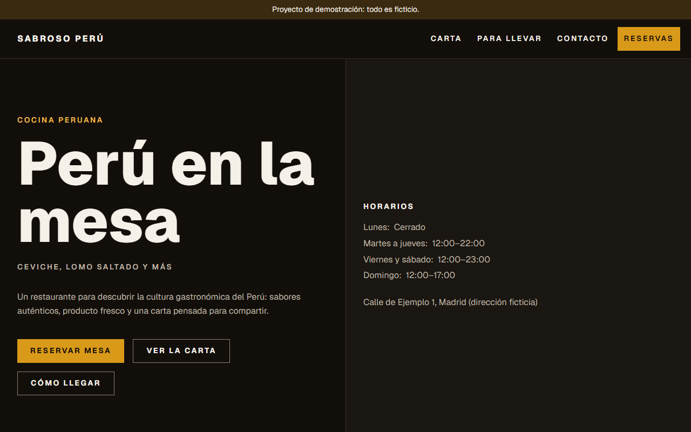
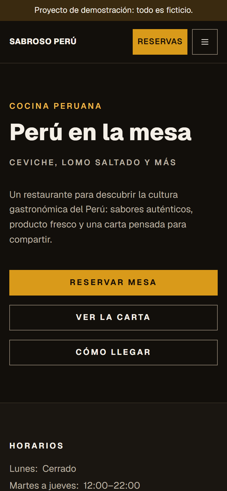
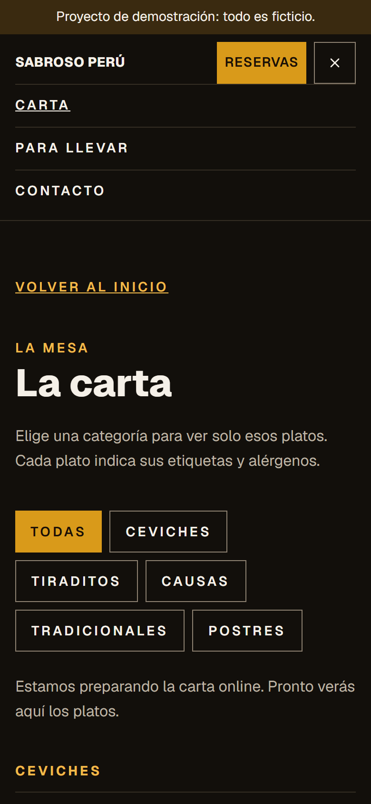
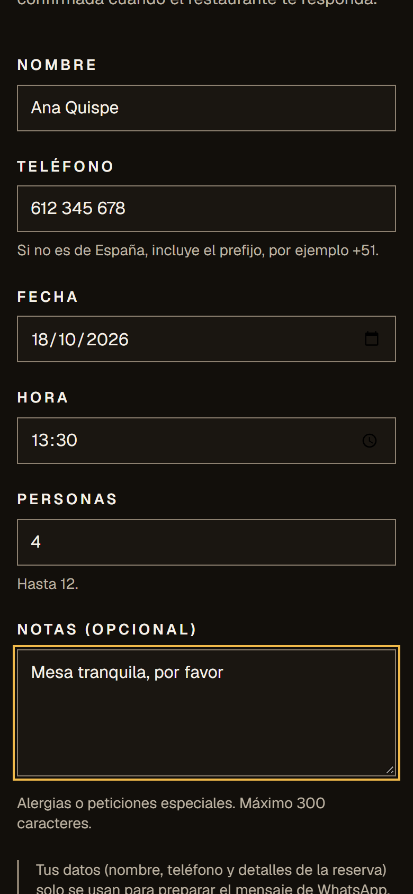
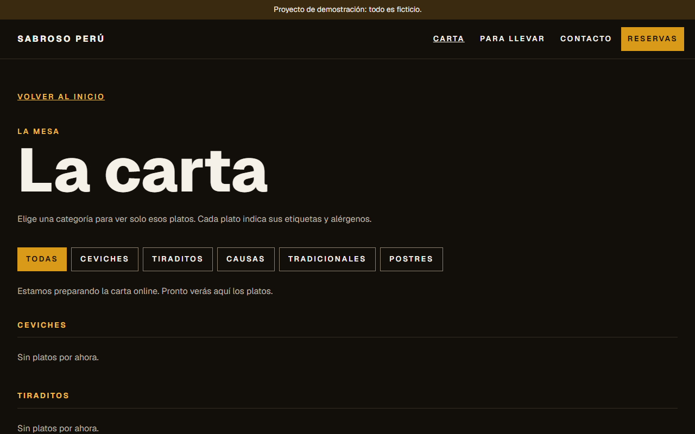
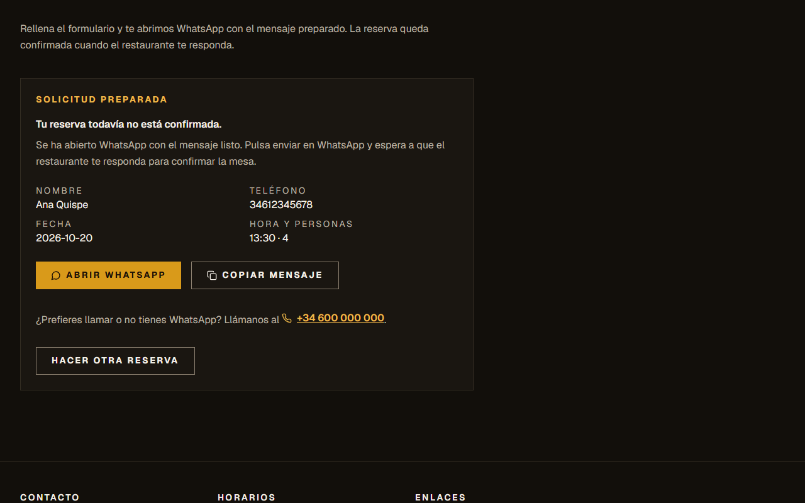

# Sabroso Perú

Sitio web de un restaurante peruano: presenta la cultura gastronómica, muestra una carta interactiva y permite reservar mesa desde el móvil o el ordenador, sin cuentas ni base de datos.

**Demo en vivo:** <https://sabroso-peru.vercel.app> · **Código:** <https://github.com/Terryqg10/sabroso-peru>

> **Proyecto de demostración.** El restaurante, los datos de contacto, los horarios y los textos son ficticios. El sitio muestra un aviso en todas las páginas y se publica con `noindex`.



| Portada (móvil) | Menú (móvil) | Reserva (móvil) |
|---|---|---|
|  |  |  |

| Carta | Confirmación de reserva |
|---|---|
|  |  |

## Qué hace

- **Reserva por WhatsApp.** Un formulario valida nombre, teléfono, fecha, hora, personas y notas, y abre un chat de WhatsApp con el mensaje preparado. No hay servidor propio, base de datos ni cookies: los datos solo existen en el navegador. Tras enviar, la web avisa de que la reserva **no está confirmada** hasta que el restaurante responda, y ofrece copiar el mensaje y un teléfono alternativo.
- **Carta interactiva.** Filtro por categoría, etiquetas (vegetariano, sin gluten, picante, para compartir), alérgenos declarados y foto opcional por plato.
- **Para llevar.** Explica cómo pedir por teléfono o WhatsApp, sin carrito ni pago.
- **Información práctica.** Horarios agrupados por días, dirección, contacto, galería, reseñas (solo citas reales con fuente y fecha) y páginas de aviso legal, privacidad y accesibilidad.
- **Accesible y rápido.** Cumple WCAG 2.1 AA como suelo, respeta `prefers-reduced-motion` y sale con 99–100 en Lighthouse.
- **Pensado para el móvil.** Desde 320 px la cabecera cabe en una fila: el botón *Reservas* siempre a la vista y el resto de enlaces en un menú desplegable (cierra con Esc o con un clic fuera). En pantallas anchas los enlaces van en línea.

## Stack

| Capa | Tecnología |
|---|---|
| Framework | Next.js 16 (App Router), React 19 |
| Lenguaje | TypeScript estricto (sin `any` ni `@ts-ignore`) |
| Estilos | Tailwind CSS 4 con tokens de diseño propios |
| Validación | Zod: los tipos se derivan de los esquemas |
| Iconos | lucide-react |
| Tests | Vitest + Testing Library (unitarios y de componentes), Playwright + axe (e2e y accesibilidad) |
| Gestor | pnpm |

## Cómo está hecho

El proyecto sigue **Spec-Driven Development**: spec → plan → tareas → implementación → revisión. Nada se implementó sin spec aprobada, y cada criterio de aceptación tiene un test o una comprobación documentada.

| Qué | Dónde |
|---|---|
| Especificación (15 requisitos y 18 criterios; la Enmienda 1 añadió 6 y 7) | [sdd/specs](sdd/specs/SPEC-001-sitio-restaurante.md) |
| Plan técnico y estado de las tareas | [sdd/plans](sdd/plans/PLAN-001-sitio-restaurante.md) |
| 11 tareas atómicas | [sdd/tasks](sdd/tasks) |
| Revisión de cada tarea, con la salida real de los comandos | [sdd/reviews](sdd/reviews) |
| Decisiones con alternativas (mercado, para llevar, reseñas, excepción de `audit`) | [sdd/adrs](sdd/adrs) |
| Análisis de la competencia (restaurantes peruanos y nikkei en España) | [research](research) |

Decisiones destacables:

- **Sistema de diseño por tokens.** Estilo *Editorial Dark* con un único acento (ají amarillo). Los componentes solo usan nombres de token: no hay colores hexadecimales ni valores arbitrarios, y `pnpm check-palette` valida los 20 pares de contraste de la paleta.
- **Lógica de negocio separada de la interfaz.** La validación de la reserva, la normalización del teléfono, el enlace de WhatsApp, el filtro de carta y los horarios son funciones puras con tests unitarios, y el reloj se inyecta para poder probar las reglas de fecha.
- **Contenido validado.** La carta, la galería y las reseñas se cargan desde archivos tipados y se validan con Zod: una foto sin texto alternativo, una cita sin fuente o una categoría inexistente hacen fallar el build.
- **Honestidad con los datos.** Sin contenido real no se inventan platos, precios, alérgenos, fotos ni reseñas: las secciones muestran un estado vacío claro.
- **Investigación previa.** El análisis de cuatro webs de la competencia dio lugar a decisiones como la reserva con confirmación explícita, el pie legal y las etiquetas de alérgenos en la carta.

## Calidad

Medido con la última versión:

| Comprobación | Resultado |
|---|---|
| Tests unitarios y de componentes | 85 |
| Tests e2e (Chromium y WebKit móvil), incluido axe | 154 (77 por proyecto) |
| Lighthouse, móvil, 9 páginas | rendimiento 99, accesibilidad 100 |
| Lighthouse, escritorio, 4 páginas | rendimiento 100, accesibilidad 100 |
| axe | sin violaciones graves en 9 páginas × 3 anchos |
| Contraste de la paleta | 20 pares conformes con WCAG AA |

Limitaciones conocidas, sin maquillar:

- axe y Lighthouse solo detectan una parte de los problemas de accesibilidad. No hay revisión con lector de pantalla ni auditoría externa.
- Los textos legales son un borrador pendiente de validación jurídica.
- `pnpm audit --audit-level=high` falla por `braces`, una dependencia de desarrollo sin parche. Está cubierta por [ADR-001](sdd/adrs/ADR-001-excepcion-audit-braces.md) hasta el 2026-11-15, y `pnpm run audit:ci` (el que usa la CI) aplica la excepción y falla solo cuando caduca.
- Con `next dev` el servidor se cae durante los e2e en la máquina de desarrollo. Los e2e se ejecutan con el servidor de producción (`CI=true`).
- El estilo visual está en borrador 0.1.0 y el hero no tiene fotografía porque no hay material real.

## Arrancar

```bash
pnpm install
pnpm dev
```

Abre <http://localhost:3000>.

Para ejecutar los tests e2e (con el servidor de producción):

```bash
pnpm build
CI=true pnpm test:e2e
```

La primera vez, instala los navegadores con `pnpm test:e2e:install`.

## Convertirlo en un sitio real

Todo lo ficticio está en [src/config/restaurante.ts](src/config/restaurante.ts): nombre, teléfono, WhatsApp, email, dirección, titular, horarios y número máximo de personas.

1. Sustituir los datos de ese archivo por los reales.
2. Poner `demo: false`: desaparecen el aviso, el `noindex` y el bloqueo de `robots.txt`.
3. Cargar los platos en `src/content/carta/datos.ts`, las fotos en `src/content/galeria/datos.ts` (con `alt` descriptivo) y las reseñas reales, con permiso, en `src/content/resenas/datos.ts`.
4. Validar jurídicamente los textos de aviso legal, privacidad y accesibilidad.

## Comandos

| Comando | Qué hace |
|---|---|
| `pnpm dev` | Servidor de desarrollo. |
| `pnpm build` | Build de producción. |
| `pnpm typecheck` | Comprueba tipos. |
| `pnpm lint` | Linter. |
| `pnpm test` | Tests unitarios y de componentes. |
| `pnpm test:e2e` | Tests end-to-end (incluye axe). |
| `pnpm check-palette` | Valida `palette.css` contra WCAG AA. |
| `pnpm check-secrets` | gitleaks. |
| `pnpm audit:ci` | `pnpm audit` con excepciones documentadas en un ADR y su caducidad. |
| `pnpm verify` | Comprobaciones de estructura. |
| `pnpm install-hooks` | Instala el hook pre-commit. |

## Cómo se trabaja

El flujo es spec → plan → tasks → implement → review. Con Claude Code: `/start` para orientarse y, según toque, `/new-spec`, `/new-task`, `/check`, `/review`, `/decide` y `/style`.

Documentos clave: [docs/constitution.md](docs/constitution.md) (invariantes y defaults) y [CLAUDE.md](.claude/CLAUDE.md) (reglas operativas).

El proyecto está ligado a una versión del OS (`.os-version`). Para recibir mejoras: `copier update` (detalle en [docs/versions.md](docs/versions.md)).
